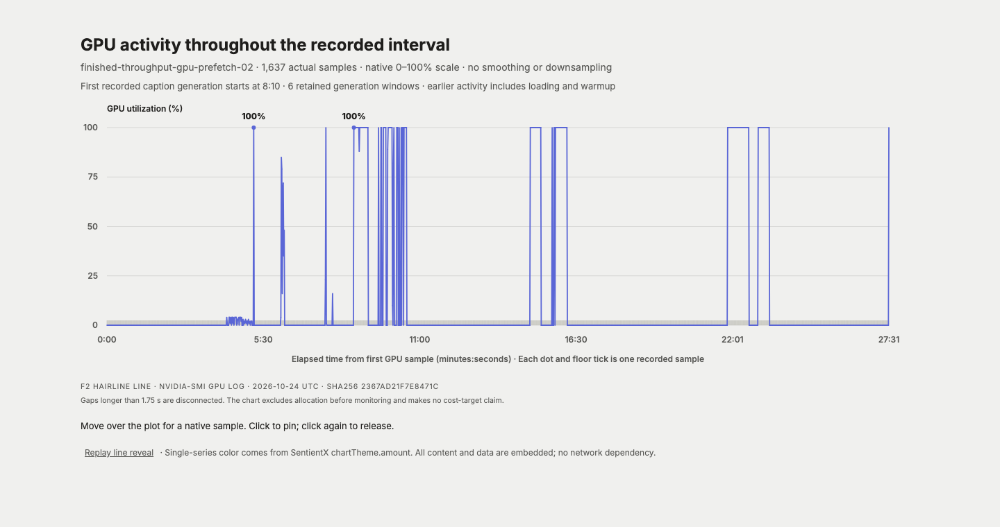

# Flora prefetch qualification — 2026-10-24

The uninterrupted qualification of the deployed four-reader prefetch implementation
did **not** achieve sustained GPU saturation or $0.70 per video-hour. It retained
363 captions across 12 of 24 submitted finished episodes, covering 1,057.859357
source seconds (17.63 minutes), before the unchanged 1,650-second worker deadline.
All 34 returned artifacts were downloaded and SHA-verified. No GPU container
remained running after collection.

This follows the [previous finished-data experiment](flora-throughput-2026-10-23.md).
The user authorized exactly one additional call with a $4 reservation and raised
the GPU campaign ceiling to $28. The call reused paid CPU caches; no CPU preparation
or uncertain previous generation was bought again. Its conservative settlement,
including a 605-second startup allowance, is $3.40638. The GPU campaign now stands
at $26.64777 against $28. This is a reservation reconciliation, not a final invoice.

## What ran

Modal app `argus-flora-research`, deployment v18, ran the implementation committed
as `c5b163453cda79769167083a519f3fe856e34454`; every submitted Flora source digest
matched the deployed implementation. The H200 allocation remained 8 CPU / 64 GiB,
with vLLM 0.24.0, 32 active sequences, one resident model, one prepared successor,
and four bounded SHA-verifying array readers. There was no mid-run intervention.

The 24 distinct episodes contain 2,032.419460 seconds and 771 supplied intervals.
They were never previously submitted to generation. Native videos, timestamps,
intervals, task context, released model revisions, native processor checks, BF16
with FP32 GDN, temperature zero and the 512-token ceiling were unchanged. This is
single-view human-gripper footage on existing Argus intervals, not a fresh
segmentation benchmark or a production Labeler default change.

## Measured cost and throughput

| Accounting boundary | USD / completed source-video hour |
| --- | ---: |
| Completed generation only | 1.264 |
| Completed production span plus first input wait | 5.585 |
| Observed batches 001–005, including inter-batch waits | 5.077 |
| Entire GPU worker, including startup within the worker and failed tail | 8.488 |
| Entire GPU worker plus measured CPU cache-creator execution | 9.579 |

The GPU worker lasted 1,654.050 seconds and costs $2.49411 at allocation list rates.
The completed captions generated in 246.346 seconds; completed production plus
initial input wait occupied 1,088.356 seconds. The post-first-batch sample is ten
episodes / 882.840 seconds, not evidence of indefinite steady state. It excludes
leading model/kernel startup, final persistence, CPU preparation and storage.

The $9.579 figure includes the full measured execution of three required CPU
creator calls at their actual 4 CPU / 32 GiB allocation, counted once. Some also
prepared retained caches not consumed here. It excludes container startup before
worker timing, local extraction, transfer, storage, and the pre-existing Argus
segmentation. It is **not all-in**, and even this boundary is well above target.
Different source batches and startup conditions prevent a paired speedup claim
against the prior run's $11.523 partial-pilot figure.

The first post-run Modal billing snapshot still showed only $1.80412 for this app
in the selected window, less than measured worker execution. It is lagging and is
not used as a final bill or a favorable cost result. Credits are excluded.

## Why the GPU was idle

The plot preserves all 1,637 one-second samples on a 0–100% axis. Mean utilization
was 11.81% across the recorded worker interval, 18.93% across the post-first-batch
production span, and 75.28% inside completed generation windows. These are separate
time boundaries. Brief 100% peaks do not establish sustained saturation.

| Batch | Captions | Source seconds | Input wait seconds | Generation seconds |
| --- | ---: | ---: | ---: | ---: |
| 000 | 59 | 175.02 | 179.90 | 61.64 |
| 001 | 51 | 146.58 | <0.01 | 59.52 |
| 002 | 52 | 186.06 | 233.38 | 23.40 |
| 003 | 56 | 180.02 | <0.01 | 32.47 |
| 004 | 96 | 211.04 | 316.11 | 44.90 |
| 005 | 49 | 159.14 | <0.01 | 24.43 |

Engine load took 296.98 seconds, including 56.90 seconds of cached compilation
(previous run: 560.42 and 282.18 seconds). First inference still compiled additional
kernels. The alternating input stalls remained despite prefetch. Read-only process
observations found the four readers fetching successor arrays while the GPU was
idle; they do not identify every internal blocking operation. No KV-cache
preemption was observed. The final prefetch snapshot was not emitted because the
deadline kills the worker process group; per-batch receipts and the GPU trace survive.

The next engineering experiment should stage and verify a bounded set of arrays
on container-local storage before handing them to inference, and measure its
transfer and hashing cost independently. The existing remote-volume warmer does
not establish that the arrays remain cheaply readable by the consumer. Increasing
sequence concurrency alone cannot remove the measured input waits. Even perfect
input delivery would leave this run's $1.264 generation-only rate above $0.70, so
hardware/configuration efficiency also needs a quality-controlled measurement.
Neither proposed improvement has been qualified by this run.

## Coverage and caption quality

Batches 000–005 completed; batches 006–011 have no retained generation intent or
result. Their 12 episodes and paid caches remain visible as incomplete coverage.
Across both finished-data GPU runs there are 686 captions for 23 distinct episodes
/ 1,947.099064 source seconds. Fifteen of 38 admitted episodes remain incomplete,
including the three uncertain episodes from the earlier run; three of the original
41 sources remain excluded for native-clock mismatches. Nothing was resampled,
silently retried, or removed from the denominator of coverage.

Every completed output passed final-receipt hashing, original interval/video/model
binding and CPU native-processor certificate checks. The earlier 16 controls matched
the baseline exactly in prompt IDs, output IDs and caption text. These checks guard
input fidelity; they do not establish caption quality parity with Astra or Sol.

Six of nine predeclared visual-audit events now have Flora outputs across the two
runs; three remain missing. In a box-handling interval, Flora says “Move the left
hand back,” omitting the object and outcome in the saved Argus description. Other
samples describe ring placement or pushing boxes more specifically. The saved
Argus/GLM 5.3 Flash annotations used additional views and are not human ground
truth; three stills per event cannot resolve all motion. All candidates and the
pre-output observations are retained. No automatic winner or Library publication
was made in this experiment.

## Remaining all-in boundaries

The submitted cohort reuses 22.013 GB of prepared arrays and 1.019 GB of uploaded
native video, apart from 109.447 GB of shared model payload. At Modal's storage list
rate, retaining the cohort arrays and native videos for one day adds a sensitivity
of $0.114 per submitted video-hour; 30 days adds $3.419. These are byte/retention
scenarios, not measured billing increments: Volume billing uses daily snapshots
and deleted bytes can remain billable for up to four days. No retained data was
deleted. Successful source transfer took 108.16 local seconds and native extraction
158.12 local seconds; no artificial zero-dollar compute price is assigned to them.
Supplied segmentation and reward inference are outside this caption benchmark.

The implementation and its existing focused/full CI checks remain available in
PR #2, but performance acceptance is unmet. This follow-up changes evidence only.
The optional Flora path remains subject to the released noncommercial research
terms; no production promotion or claim of SOTA quality follows from this result.

[Machine-readable result and evidence hashes](flora-throughput-2026-10-24.json).
Private raw outputs, journals, quality comparisons, billing snapshots and the
interactive utilization chart remain under ignored `data/flora-throughput-run/`
and `data/flora-qualification/finished-throughput-gpu-prefetch-02.artifacts/`.

Sources: [Modal allocation prices](https://modal.com/pricing),
[billing latency](https://modal.com/docs/guide/billing),
[Volume billing and behavior](https://modal.com/docs/guide/volumes),
[Flora paper, Appendix D](https://research.nvidia.com/labs/gear/flora/assets/paper/flora.pdf?v=2026-10-19c).
